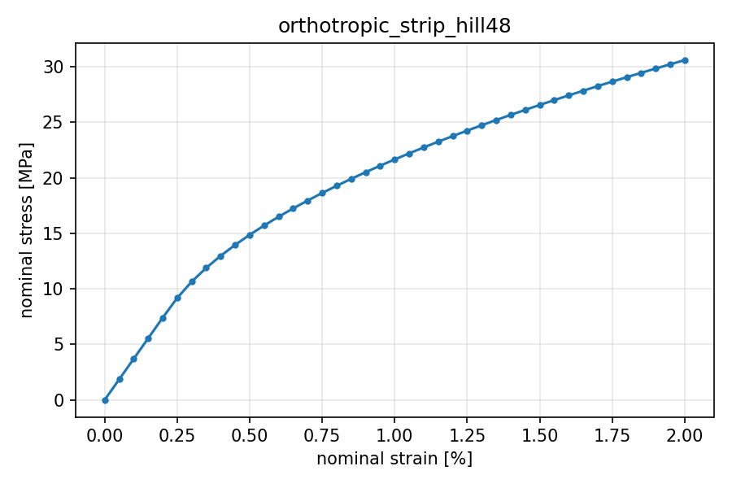

# Plane-stress anisotropic plasticity

A compact finite element solver for **anisotropic elasto-plasticity in plane stress** (small strains).
It is a single script, [`planestress.py`](planestress.py), driven by a JSON input file.

- **FEniCSx (dolfinx)** handles the mesh, the weak form, assembly and the global Newton–Raphson solver.
- **JAX** handles the material model: a return mapping at every integration point with an
  automatically differentiated **consistent tangent**. The material model is vectorised with `vmap` and compiled with `jit`.

## Features

| | options |
|---|---|
| Elasticity | isotropic (`E`, `nu`) or orthotropic (`E1`, `E2`, `nu12`, `G12`) rotated by `orientation_deg` |
| Yield criterion | von Mises, Hill48 (anisotropic, rotated with the material axes) or none (pure elasticity) |
| Isotropic hardening | linear `R = H p`, power law `R = c((p + p0)^(1/d) - p0^(1/d))` |
| Kinematic hardening | linear (Prager), `alpha = 2/3 H_kin eps_p` |
| Load cases | `tension_x`, `tension_y`, `clamped_y`, `shear` (displacement controlled) |
| Output | `curve.csv`, `stress_strain.png`, `results.xdmf` (displacement, von Mises stress, equivalent plastic strain, viewable in ParaView) |

## Method

The plane-stress condition `sigma_zz = 0` is built into the reduced stiffness.
Both yield criteria are pressure-insensitive, so plastic flow conserves volume and
`eps_p,zz = -(eps_p,xx + eps_p,yy)`. The return mapping therefore needs only four local unknowns,
`[eps_p,xx, eps_p,yy, gamma_p,xy, dlambda]`, solved with a backward-Euler Newton scheme.

The consistent tangent follows from implicit differentiation of the converged local residual `r(x, eps) = 0`:

```
dx/deps = -(dr/dx)^-1 dr/deps,     D = C (I - d eps_p / d eps)
```

`jax.jacfwd` supplies both Jacobians, so a new yield function or hardening law takes only a few lines.
Hill48 coefficients come from the yield stress ratios `R11, R22, R33, R12`. Setting all of them to 1 recovers von Mises.

## Installation

FEniCSx (dolfinx, PETSc, MPI) has no PyPI wheels, so it comes from conda. All other
dependencies are managed by [uv](https://docs.astral.sh/uv/) in a virtual environment built
on top of the conda Python, so it can see dolfinx:

```bash
conda create -n fenicsx-env -c conda-forge python=3.13 fenics-dolfinx mpich
uv venv --python "$(conda run -n fenicsx-env which python)" --system-site-packages
uv sync
```

Use `uv add <package>` to add a dependency. Once `.venv` exists, `uv sync` and `uv run` reuse it.

## Run

```bash
uv run python planestress.py example.json
```

Results are written to `output/<name>_<timestamp>/`.

## Example

[`example.json`](example.json) models a 15 × 100 mm orthotropic strip (paperboard-like) under tension
with clamped ends. The material axis 1 is rotated 30° from x, and the model uses Hill48 yielding with power-law hardening.



### Input file reference

```jsonc
{
  "name": "my_run",
  "geometry":  { "width": 15, "height": 100, "thickness": 0.3, "nx": 6, "ny": 40 },
  "material": {
    "orientation_deg": 30,                                   // material axis 1 vs. global x
    "elasticity": { "model": "isotropic", "E": 210000, "nu": 0.3 },
    //            { "model": "orthotropic", "E1": .., "E2": .., "nu12": .., "G12": .. }
    "plasticity": {                                          // null -> purely elastic
      "yield": "von_mises",                                  // or "hill48" + "hill_ratios"
      "yield_stress": 250,
      "hill_ratios": { "R11": 1, "R22": 0.55, "R33": 0.6, "R12": 0.6 },
      "isotropic_hardening": { "law": "linear", "H": 1000 },
      //                     { "law": "power", "c": 473.9, "d": 2.023, "p0": 1e-8 }
      "kinematic_hardening": 0.0
    }
  },
  "loading":  { "type": "clamped_y", "max_displacement": 2.0, "num_steps": 40 },
  "numerics": { "element_degree": 1, "quadrature_degree": 2 }   // optional
}
```

## Verification

These checks were run against analytical uniaxial solutions:

- von Mises with linear isotropic + kinematic hardening: `sigma = sigma_y0 + E H/(E+H) (eps - sigma_y0/E)`, relative error about 1e-13
- pure elasticity: relative error about 1e-16
- Hill48 loaded along material axis 2 with perfect plasticity: plateau at exactly `R22 * sigma_y0`
- the global Newton iterations converge quadratically (about 3 iterations per load step), which confirms the consistent tangent

## References

- R. Hill (1948), *A theory of the yielding and plastic flow of anisotropic metals*, Proc. R. Soc. Lond. A 193.
- M. Alzweighi et al. (2021): power-law hardening for paperboard.
- J. Bleyer, *Numerical tours of computational mechanics with FEniCSx*.
